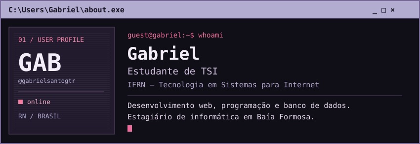
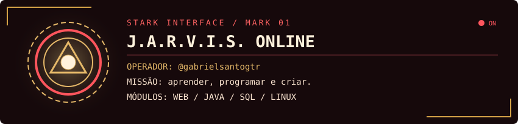
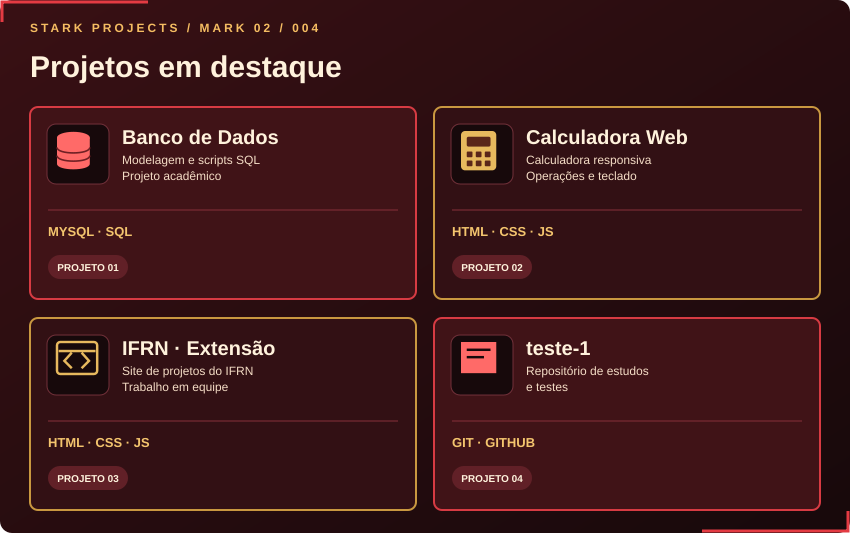

  
    
  
   
   
  

<h2 align="center">⚙️ Arsenal tecnológico</h2>

<table>
  <tr>
    <td width="50%" valign="top" align="center">
      <b>Programação</b>  
      &nbsp; &nbsp;   
    </td>
    <td width="50%" valign="top" align="center">
      <b>Front-end</b>  
      &nbsp;   
    </td>
  </tr>
  <tr>
    <td valign="top" align="center">
      <b>Banco de dados</b>  
        
    </td>
    <td valign="top" align="center">
      <b>Ferramentas</b>  
      &nbsp; &nbsp; <picture><source media="(prefers-color-scheme: dark)" srcset="https://cdn.simpleicons.org/github/f4c56e"></picture>  
    </td>
  </tr>
</table>

  
    
  <a href="https://github.com/gabrielsantogtr/Banco-de-Dados">Banco de Dados</a> ·
  <a href="https://github.com/gabrielsantogtr/calculadora">Calculadora Web</a> ·
  <a href="https://github.com/vicccviccc/ifrncangVRGP">IFRN — Projetos de Extensão (colaborativo)</a> ·
  <a href="https://github.com/gabrielsantogtr/teste-1">teste-1</a>
    
  
  

<h2 align="center">📡 Central de Monitoramento JARVIS</h2>

  
  

  
   
  
   

<h2 align="center">🛠️ Laboratório Stark</h2>

  
Projetos de estudo, experimentos e novas ideias.

  

